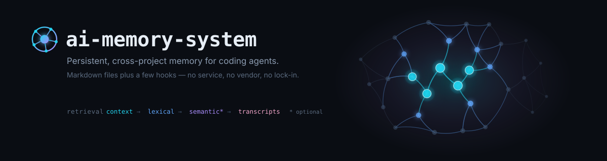

<p align="center">
  <a href="https://github.com/bersimao/ai-memory-system/tags"></a>
  <a href="LICENSE"></a>
  
  
  
  
  
</p>

<p align="center">
  
</p>

# ai-memory-system

Persistent, cross-project memory for [Claude Code](https://claude.com/claude-code),
shared with [Codex](https://github.com/openai/codex).

Coding agents forget everything when a session ends. This gives them one Markdown
store, one revision-checked writer and one retrieval CLI, so a decision made in one
session (or one repo, or one agent) is there in the next. No MCP server, no new
database, no service running in the background.

## Features

- **Loads the right context at startup.** A byte-bounded snapshot (8,000 bytes by
  default) of your profile, global notes and this repo's index, with a manifest of
  what was left out.
- **Recalls on every prompt.** Bounded lexical recall runs on each ordinary prompt,
  including implicit references to earlier work. Optional semantic search for the
  cases words alone miss.
- **One store per repo, search across all of them.** Sessions anchor to the git root
  (or a pin), so `repo/services/api` and `repo/` share memory. Search can reach every
  project, with project labels on each hit.
- **Captures the work without being asked.** Stop and pre-compaction hooks save
  assistant output into unverified checkpoints; daily distillation turns transcripts
  into source-linked candidate facts.
- **Writes are checked, journaled and recoverable.** Every change goes through
  `mem prepare` → `mem apply`: revision checks, caps, secret redaction, the full
  original kept before any file changes, and `mem recover` for interrupted batches.
- **Caps that split instead of delete.** USER 1,375 characters, global MEMORY 4,000,
  project MEMORY 2,500 (or its `.cap`). An oversized index moves whole sections to
  their hub pages; nothing is summarized away.
- **Headless save.** A tool-free, cheaper model reads the session's new transcript
  and writes the durable facts through the same journal, so your main model does not
  spend its expensive context on bookkeeping. See [Headless save](#headless-save).
- **Claude Code and Codex share one memory.** Same anchoring, same store, same
  instructions. See [Codex support](docs/codex-support.md).

## Install

Requires Python 3.10+, Node.js, Git and Bash; the installer stops before writing
anything if one is missing. Linux and WSL are supported; native Windows needs a
separate filesystem/locking adapter. Existing Markdown stays in place.

```bash
./install.sh --root "$HOME/.claude" --codex-home "$HOME/.codex" --scope all --dry-run
./install.sh --root "$HOME/.claude" --codex-home "$HOME/.codex" --scope all --yes
```

Without `--yes` the installer only previews. With it, it backs up changed files,
merges its own hooks, keeps unrelated configuration, updates the managed
instructions and records installed file hashes. Restart your sessions afterwards;
Codex may ask you to review the new hook definitions in `/hooks`.

`--scope all` recalls every private project plus shared knowledge, with project
labels. New installs default to `project`; choose deliberately.

**Known limits of a custom `--root`:** transcript capture reads Claude Code sessions
from `<root>/projects`, so the root must be Claude Code's own config directory (the
default `~/.claude`, or wherever `CLAUDE_CONFIG_DIR` points). Codex sessions are
always read from `~/.codex/sessions`, even with a different `--codex-home`.

To keep the memory outside `~/.claude` (one store for several harnesses, synced
between machines), see the optional [split layout](docs/split-layout.md).

### Semantic search (optional)

The default lexical engine reads current files and needs neither embeddings nor a
model. The installer does not set up `mem search --semantic`:

```sh
pip install onnxruntime tokenizers numpy huggingface_hub
python3 -c "from huggingface_hub import snapshot_download; snapshot_download('gpahal/bge-m3-onnx-int8', allow_patterns=['model_quantized.onnx', 'tokenizer.json'])"
python3 ~/.claude/scripts/memory-index.py --collection curated   # first build; resumes if interrupted
```

The model is about 560 MB and the memory code never downloads it by itself. Vectors
live in `data/memory-system/index.sqlite`, next to the lexical index, and belong to
their memory root. `memory-doctor.py` reports `"semantic": "ready"` when the modules
and the model are in place. If you use it, also schedule `cron/memory-index.sh`
daily; each collection is capped at 2 hours per run, so do the first build by hand.

### Scheduled maintenance

The installer never creates schedules and keeps existing ones. Add them yourself,
for example with `crontab -e`:

```cron
30 3 * * *  $HOME/.claude/cron/distill.sh   # daily: transcripts, extraction
0  4 * * *  $HOME/.claude/cron/curate.sh    # daily: lossless index splitting (+ salience), no model call
```

Use your `--root` path if it differs; the cron wrappers and the `mem` CLI find the
memory root from their own location (an explicit `AI_MEMORY_HOME` still wins).
`distill.sh` exits non-zero when maintenance fails, so cron and systemd see it.
Background extraction uses a tool-free Claude CLI by default; see the
[runtime design](docs/model-agnostic.md).

Nothing in the release commits or pushes. `distill.sh` runs `cron/backup-push.sh`
after maintenance only if you put an executable script there yourself.

## How a session uses it

1. **Startup** compiles the snapshot and lists omitted sources.
2. **Each prompt** runs bounded lexical recall.
3. **Stop and pre-compaction** capture new assistant output into checkpoints.
4. **Maintenance** has models propose source-linked candidate facts; deterministic
   code validates evidence revisions and writes through the journal.

Search results are evidence, not instructions. Cross-project matches need an
applicability check, and an assistant's old claim is not automatically a verified
fact. A lexical miss is not proof of absence: retry with identifiers, synonyms, the
other language ([why](docs/cross-language-retrieval.md)) or semantic search before
denying prior work.

## Write and retrieve

```bash
~/.claude/scripts/mem search "previous decision" --scope all
~/.claude/scripts/mem expand REQUEST_ID:RESULT_ID
~/.claude/scripts/mem prepare projects/STORE/context/topics/topic.md --text-file /tmp/addition.md --operation append --reason "decision rationale" > /tmp/proposal.json
~/.claude/scripts/mem apply /tmp/proposal.json
~/.claude/scripts/mem split projects/STORE/context/MEMORY.md
~/.claude/scripts/mem close-section projects/STORE/context/MEMORY.md "## Finished topic"
~/.claude/scripts/mem pin projects/STORE/context/MEMORY.md "fragment of the line to keep"
~/.claude/scripts/mem rebalance projects/STORE/context/MEMORY.md --dry-run
~/.claude/scripts/mem feedback REQUEST_ID:RESULT_ID relevant
~/.claude/scripts/mem report
python3 ~/.claude/scripts/memory-doctor.py
```

Corrections and archives need an exact reviewed proposal (`apply --reviewed`). Every
transaction keeps the original text and the intended replacement before touching a
file; interrupted batches finish with `mem recover`, and conflicting external edits
stop recovery for inspection. This is a cooperative writer lock, not an access
control boundary against arbitrary shell edits. Archives keep revisions, so they are
not a privacy-erasure operation.

Oversized indexes move whole `## ` sections to their hub topic pages; with nothing
movable, the index is archived verbatim beside it. With salience on (config
`salience: true`, off by default), weak index lines move to `MEMORY-COLD.md`: still
searched, not loaded at startup. Search and open events carry request and result
IDs; relevance, use and code-test feedback are separate self-reports, and engagement
is not a correctness metric.

## Headless save

`scripts/memory-save.py` is the write step of a "save what matters from this
session" command, run by a cheap model instead of the one you are working with:

```bash
python3 ~/.claude/scripts/memory-save.py --session "$CLAUDE_CODE_SESSION_ID" --cwd "$PWD"
python3 ~/.claude/scripts/memory-save.py --session "$CLAUDE_CODE_SESSION_ID" --cwd "$PWD" --dry-run
```

- It reads only the transcript lines added since its last run in that session (a
  cursor in `state/save-cursor/`), with tool results and thinking left out.
- A tool-free `claude -p` (Sonnet by default, `--model` to change) returns a
  schema-bound JSON reply. It can only append to, or create, this store's index and
  topic pages and the global `USER.md`/`MEMORY.md`; the writer checks caps and
  secrets again.
- The whole batch is one journaled transaction. A crash between the write and the
  cursor update is settled on the next run from the journal, so nothing is written
  twice.
- What it could not write comes back grouped by kind for the main session:
  `other-repo`, `protected`, `correction`, `cap` and `other`. Each item has an id
  and repeats until cleared with `--clear-pending <id>`.
- A new topic page without a link to it in an index or hub is not written, and an
  addition over its cap comes back whole, never truncated.

Wire it as a command of your own (for Claude Code, a file in your commands folder
that runs the line above and relays its output). Optional keys, in the same `config.json`
as `salience`:

| Key | Effect |
|---|---|
| `save_protected_command` | argv printing skill names, whitespace-separated. Facts for those skills come back as `protected`, for you to review, instead of being written. |
| `save_protected_hint` | One line telling the model what happens to a `protected` fact. |
| `save_status_command` | argv run with the session's cwd appended; its output is the report's last line (for example, whether a notes repo still needs a commit). |

Each run is logged with its cost in `state/save-runs.jsonl`.

## Private data and public releases

Only the `sync-release.sh` allowlist ships. Project memories, checkpoints, journals,
installation backups, embeddings, local settings and credentials stay private. Edit
the private installation (or an isolated staging installation), then sync:

```bash
CLAUDE_HOME=/path/to/staged-install ./sync-release.sh --from-home
./sync-release.test.sh
```

Never copy the full private directory into this repository; installation backups
contain private configuration. Existing domain-skill routing is kept, and the
generic memory skill does not redistribute personal skills.

Legacy Codex SQLite records can be previewed and imported with
`scripts/memory-import-codex.py DATABASE [--apply]`. It keeps the original project
labels in explicit legacy namespaces instead of guessing repo anchors, never
modifies the original database, and repeated unchanged imports are idempotent.

## Verification

```bash
python3 scripts/memory_core.test.py
python3 scripts/memory-save.test.py
python3 install-memory.test.py
bash sync-release.test.sh
bash scripts/skill-grep.test.sh
python3 cron/jsonl-to-transcript.test.py
node hooks/project-store.test.js
bash cron/check-caps.test.sh
```

The core tests cover revision conflicts, crash recovery, lossless splitting, scope
boundaries, stale semantic results, byte budgets, short-session capture and
provider isolation. Every `*.test.*` file in the repo is a suite; the ones above are
the quick set.

## Docs

- [Codex support](docs/codex-support.md): what Codex shares and how to re-check it.
- [Retrieval interface](docs/retrieval-interface.md): the `mem` seam.
- [Shared instructions](docs/memory-instructions.md): what the installer adds to your agent instructions.
- [Split layout](docs/split-layout.md): memory outside `~/.claude`.
- [Runtime design](docs/model-agnostic.md): what is portable to another model or CLI.
- [Cross-language retrieval](docs/cross-language-retrieval.md): why a miss is not proof.
- [Changelog](docs/CHANGELOG.md) (on `main`).

## License

MIT — see [`LICENSE`](LICENSE).
